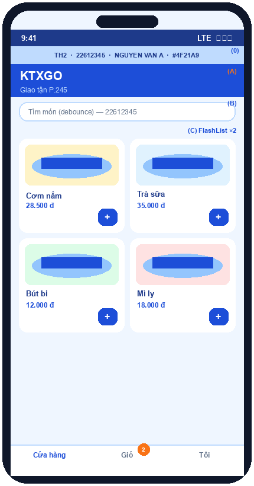
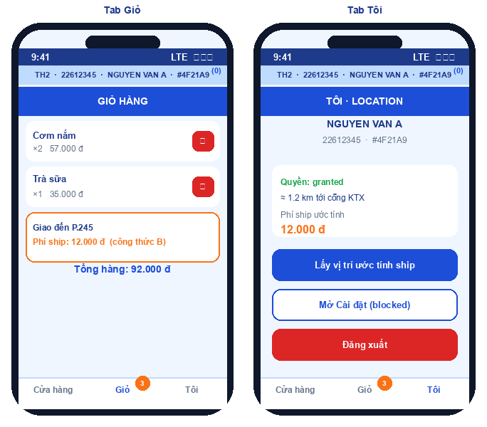

# ĐỀ KIỂM TRA THỰC HÀNH 2 — KTXGO
**Họ và tên:** NGUYEN DINH PHONG  
**MSSV:** 23698831  
**URL Clone HTTPS:** `https://github.com/phonglaisoron/23698831_TH2.git`  
**Stamp:** #448604  
**Số cuối MSSV:** 1  
**Hàng VARIANT:** Watermark: Dưới | Ô Login: phone | Thứ tự Tab: Shop→Giỏ→Tôi | Haptic: selection | Phí: B | Detail: card  

---

## 📱 Thông tin chi tiết cấu hình biến thể (MSSV: 23698831 - Số cuối: 1)
- **STUDENT_SEED:** 831
- **DEBOUNCE_MS:** 400 ms
- **STALE_TIME_MS:** 21,000 ms
- **PRICE_MULTIPLIER:** 30,500
- **BASE_SHIP_FEE:** 9,000 đ
- **ROOM_LABEL:** P.131
- **BANNER_IMAGE_ID:** 281
- **Công thức phí ship B:** `BASE_SHIP_FEE + Math.round(km * 1500) + 2000`
- **Haptic feedback:** `selection` (`expo-haptics`)

---

## 🏗️ Kiến trúc thư mục dự án
```
KTXGo_23698831/
├── README.md
├── App.tsx
├── package.json
├── babel.config.js
├── tsconfig.json
├── docs/
│   ├── screenshot-th2-home.png
│   └── screenshot-th2-cart.png
└── src/
    ├── constants/
    │   ├── student.ts
    │   └── theme.ts
    ├── hooks/
    │   ├── useDebouncedValue.ts
    │   └── useCampusLocation.ts
    ├── services/
    │   ├── apiClient.ts
    │   └── productApi.ts
    ├── stores/
    │   ├── authStore.ts
    │   └── cartStore.ts
    ├── navigation/
    │   ├── RootNavigator.tsx
    │   ├── AuthStack.tsx
    │   ├── MainTabs.tsx
    │   └── ShopStack.tsx
    ├── components/
    │   ├── ProductCard.tsx
    │   └── Watermark.tsx
    └── screens/
        ├── LoginScreen.tsx
        ├── HomeScreen.tsx
        ├── DetailScreen.tsx
        ├── CartScreen.tsx
        └── MeScreen.tsx
```

---

## 📸 Ảnh chụp màn hình ứng dụng

### 1. Màn hình Cửa hàng (Home Screen)


### 2. Màn hình Giỏ hàng (Cart Screen)


---

## 🚀 Hướng dẫn cài đặt và chạy ứng dụng

```bash
# 1. Cài đặt dependencies
npm install

# 2. Khởi động Metro Bundler
npm start

# 3. Chạy trên thiết bị / máy ảo Android
npm run android
```
